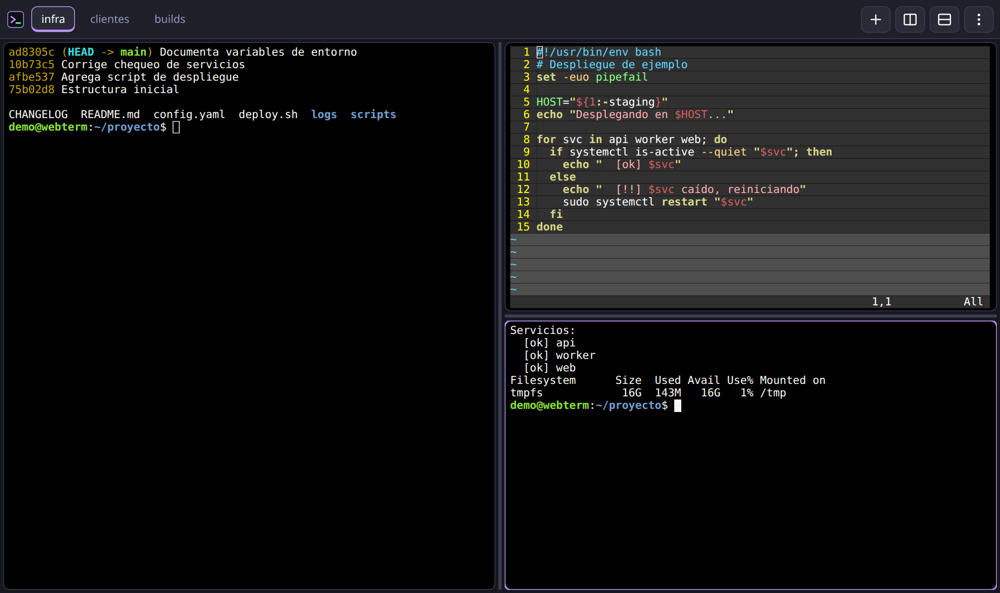
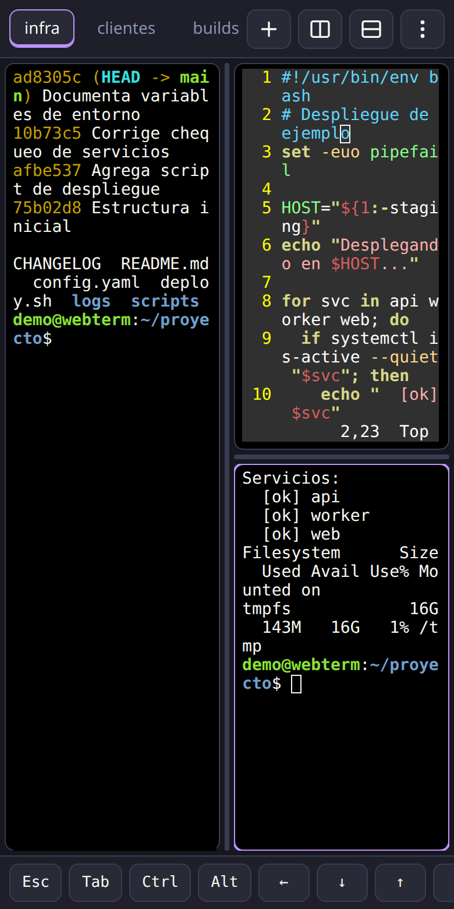
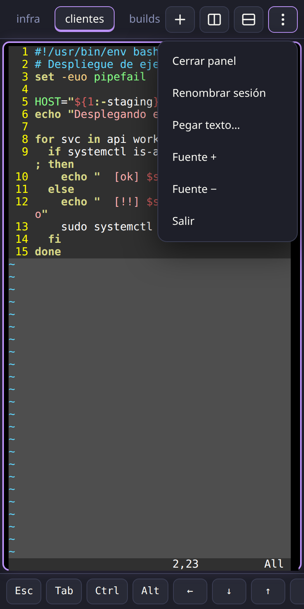

# webterm

Terminal web multi-sesión, pensada para manejar una workstation Linux desde el celular (por VPN, por ejemplo) sin instalar un emulador de terminal. Tiene un estilo parecido a Tilix: **sesiones** entre las que se rota y **splits** laterales u horizontales dentro de cada una.

La terminal es real: el servidor abre un pseudo-terminal (`node-pty`) con tu shell, así que funcionan Tab, las TUI (vim, htop, tmux), los colores, etc. [xterm.js](https://xtermjs.org) solo dibuja la pantalla en el navegador.

<p align="center">
  
</p>

<p align="center">
  
  &nbsp;
  
  &nbsp;
  
  &nbsp;
  
</p>

<p align="center">
  
  &nbsp;
  
</p>

> ⚠️ **Quien entra tiene una shell completa con el usuario que corre el servidor.** Usá contraseñas largas, exponelo solo dentro de una VPN o red de confianza y, si salís a una red no confiable, poné TLS (ver más abajo).

## Requisitos

- Linux (usa `/proc` y systemd).
- Node.js 18 o superior.
- Herramientas de compilación para `node-pty` (no trae binarios precompilados para Linux):
  `sudo apt install build-essential python3` (Debian/Ubuntu) o equivalente.

## Instalación

```bash
git clone <url-del-repo> webterm && cd webterm
npm install
node setup.js
```

`node setup.js` es un asistente que:

1. Crea un usuario y contraseña (mínimo 12 caracteres; se guarda con scrypt en `data/users.json`).
2. Pregunta si querés instalarlo como **servicio de usuario de systemd** (puerto e interfaz de escucha incluidos). Activa `linger`, así arranca al bootear sin sesión abierta, y se reinicia solo si falla.

Después abrí `http://<ip-de-la-pc>:8022` desde cualquier dispositivo con acceso.

Si preferís no usar el servicio: `npm start` (variables `PORT` y `HOST`, por defecto `8022` y `0.0.0.0`).

### Comandos de `setup.js`

| Comando | Qué hace |
|---|---|
| `node setup.js` | Asistente completo (usuario + servicio) |
| `node setup.js user [nombre]` | Crea un usuario o cambia su contraseña |
| `node setup.js service [--port N] [--host H] [--no-start]` | Instala/actualiza el servicio |
| `node setup.js uninstall` | Desinstala el servicio (conserva `data/`) |

Servicio: `systemctl --user status|restart|stop webterm` · logs: `journalctl --user -u webterm -f`.
Reiniciar el servicio **cierra las shells abiertas**; recargar la página en el navegador no.

## Uso

- **Sesiones**: pestañas arriba. `＋` crea una; tocar la pestaña activa la renombra.
- **Splits**: botones de dividir lateral / horizontal. Anidables; los divisores se arrastran. El panel nuevo abre en el directorio del panel actual.
- **Persistencia**: las shells viven en el servidor. Si se corta la conexión reconecta sola y recupera la salida reciente (256 KB por panel); el layout se restaura al volver a entrar, incluso desde otro dispositivo.
- **Archivos**: el botón de carpeta abre un explorador del equipo (siempre arranca en el home). Permite navegar, **descargar** archivos (las carpetas bajan como `.tar.gz`), **subir** archivos desde el dispositivo (selector nativo del celular o arrastrar y soltar en escritorio; varios a la vez, con progreso), crear carpetas, renombrar y borrar (menú `⋯` de cada fila, con botones y confirmación para borrar). Una subida nunca pisa un archivo existente: agrega ` (1)`, ` (2)`… al nombre. Por defecto oculta los archivos que empiezan con punto (botón "Ocultos").
- **Celular**: barra inferior con Esc, Tab, Ctrl/Alt (un toque = próxima tecla, dos = fijo), flechas, Home/End, PgUp/PgDn y símbolos frecuentes. Menú ⋮: cerrar panel, fuente, "Pegar texto…" (la API del portapapeles no está disponible por HTTP sin TLS).
- **Atajos de escritorio**:

| Atajo | Acción |
|---|---|
| Ctrl+Alt+R / Ctrl+Alt+D | Dividir lateral / horizontal |
| Ctrl+Alt+T | Nueva sesión |
| Ctrl+Alt+W | Cerrar panel |
| Ctrl+Alt+flechas | Mover el foco entre paneles |
| Alt+PgUp / Alt+PgDn, Alt+1…9 | Cambiar de sesión |

## Seguridad

- Login con usuario y contraseña propios (independientes de sudo). Cookie `HttpOnly` + `SameSite=Strict`, vence a las 12 h sin uso.
- Tras 5 intentos fallidos desde una IP, esa IP se bloquea con espera creciente (hasta 15 min).
- El WebSocket exige sesión y verifica `Origin`; las peticiones que modifican estado también.
- **HTTP plano por defecto.** Si el tráfico no va por una VPN, activá TLS: `TLS_CERT=/ruta/cert.pem TLS_KEY=/ruta/key.pem` (en el servicio, agregá esas líneas `Environment=` a la unidad) o ponelo detrás de un reverse proxy con HTTPS.
- El explorador de archivos accede con los permisos del usuario que corre el servidor (los mismos que tiene su shell). No permite borrar `/`, el home ni sus carpetas superiores; las subidas se escriben en un temporal y se renombran al terminar, y una subida cancelada no deja residuos.
- Para escuchar solo en local (por ejemplo detrás de un túnel SSH): `node setup.js service --host 127.0.0.1`.

## Auditoría

Cada evento se guarda como una línea JSON en `data/audit.log` (rota a `.1` a los 10 MB) y también va al journal de systemd:

`login_ok`, `login_fail`, `login_blocked`, `logout`, `attach`/`detach` (con IP), `ws_denied`, `pane_new`, `pane_close`, `pane_exit`, `cmd` y las del explorador de archivos: `fs_download`, `fs_upload`, `fs_mkdir`, `fs_rename`, `fs_delete` (con usuario, IP y ruta).

Los **comandos** se obtienen de un hook de bash (`shell/bashrc.webterm`, que carga tu `~/.bashrc` y reporta cada comando ejecutado). Limitaciones: solo bash; solo lo que corre en la shell local del panel (no dentro de un `ssh` o de vim); y no es a prueba de manipulación — quien tiene la shell puede evadirlo. En las shells de webterm se desactivan `HISTCONTROL`/`HISTIGNORE` para no omitir comandos repetidos ni con espacio inicial. Para auditoría forense, usá auditd.

## Estructura

```
server.js            servidor HTTP/WebSocket, auth, PTYs, auditoría
setup.js             usuarios e instalación del servicio
public/              cliente (login, app, estilos, favicon); sin paso de build
shell/bashrc.webterm hook de bash para registrar comandos
data/                (ignorado por git) usuarios, layouts, auditoría
```

## Problemas comunes

- **`npm install` falla compilando node-pty**: faltan `build-essential` / `python3`.
- **`posix_spawn failed` al abrir un panel**: `npm rebuild node-pty`.
- **El servicio no arranca tras reiniciar la PC**: verificá `loginctl show-user $USER -p Linger` (debe decir `yes`; si no, `sudo loginctl enable-linger $USER`).
- **Texto duplicado con el teclado del celular**: ya está resuelto con un campo de entrada propio en pantallas táctiles; si ves algo raro, abrí un issue con el ejemplo exacto.
