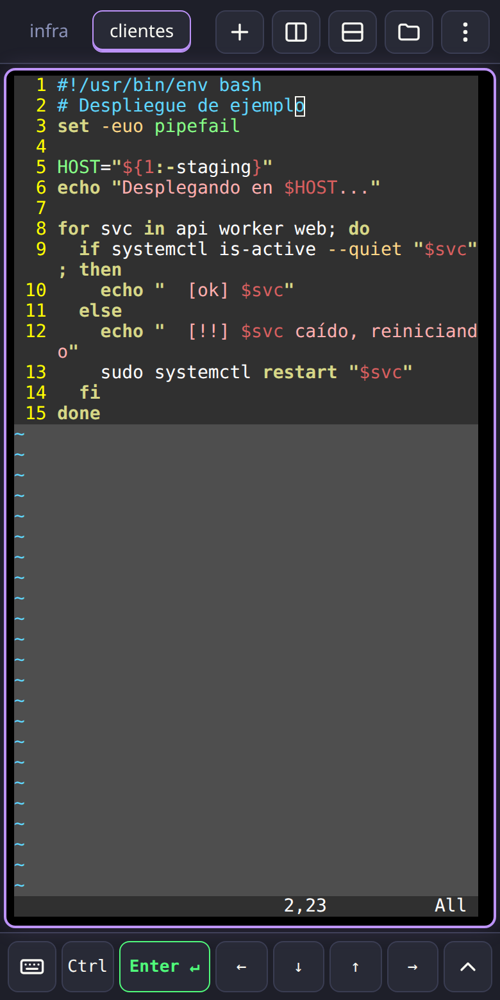
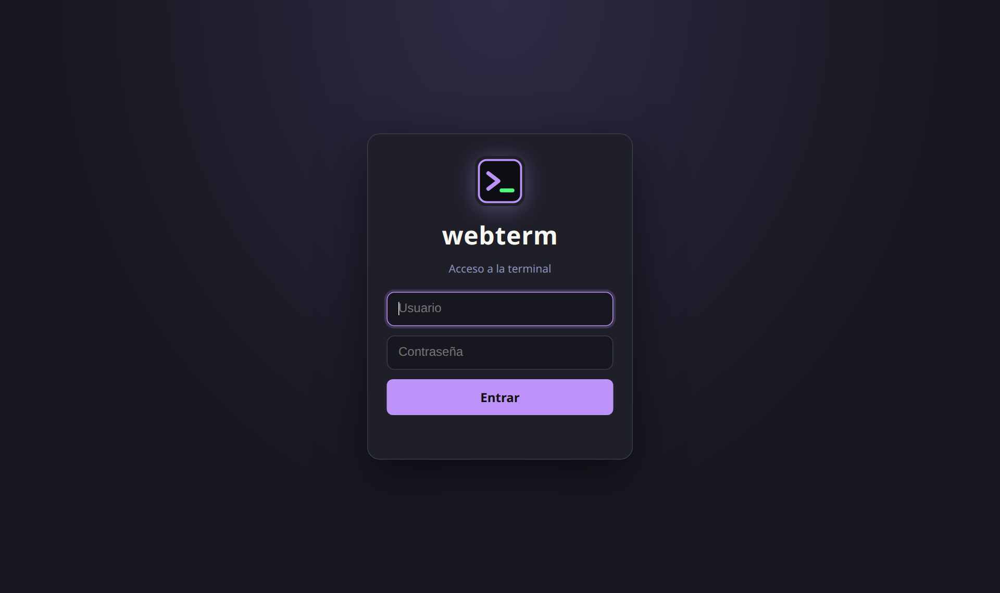
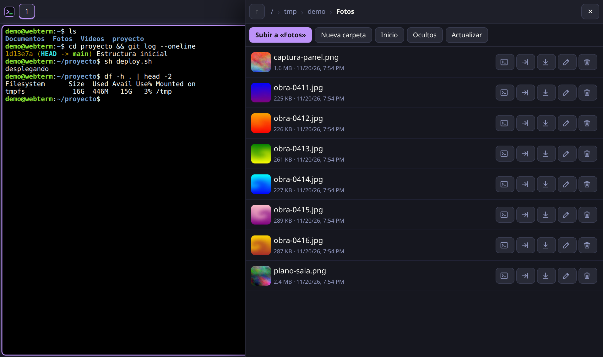
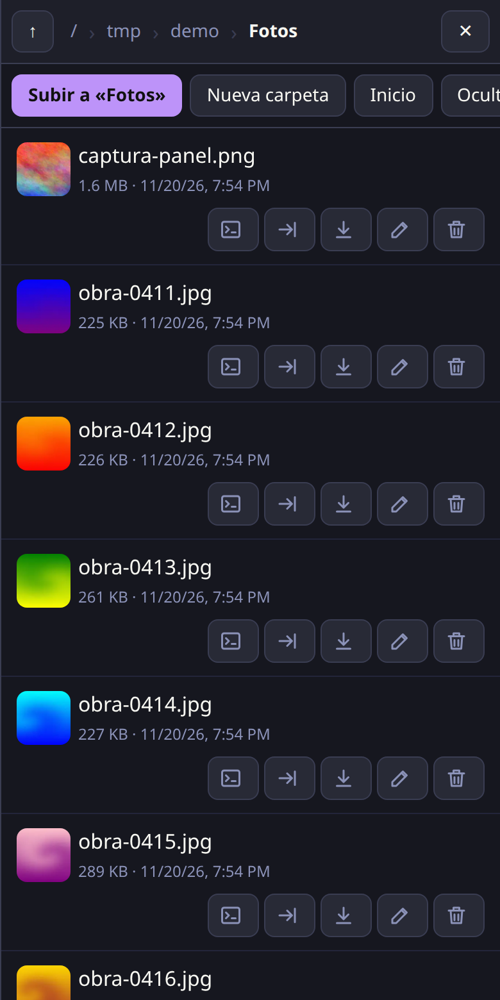
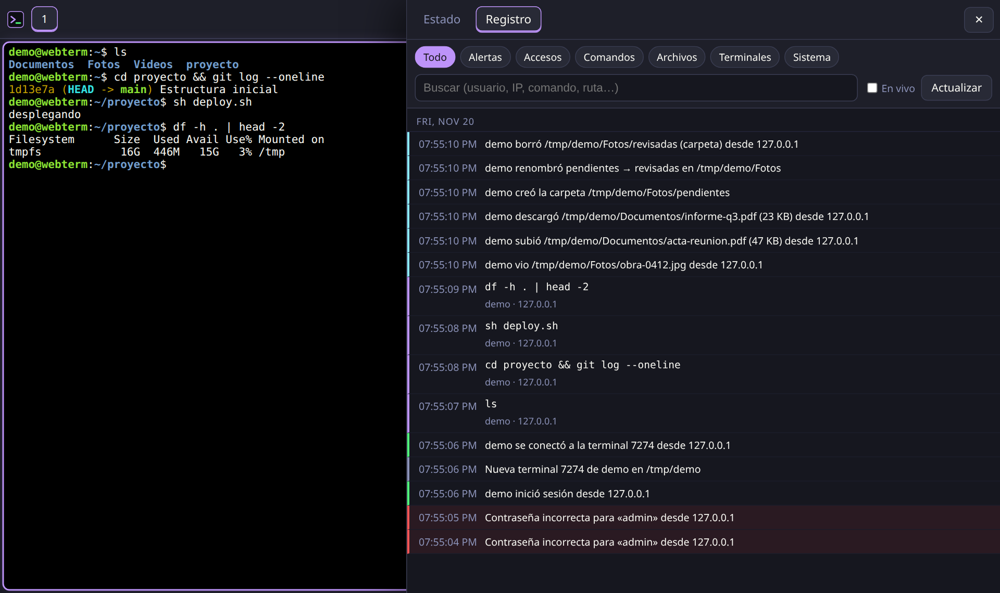
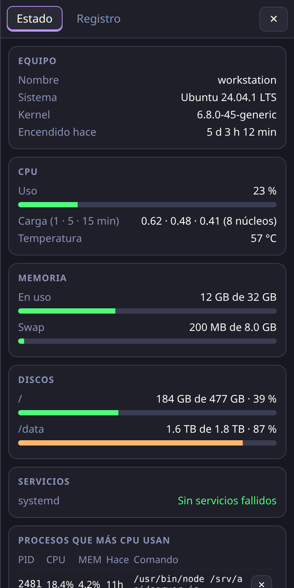
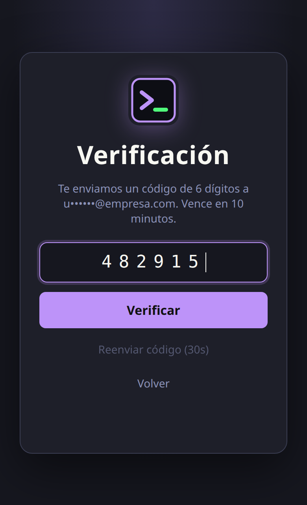

# webterm

Terminal web multi-sesión, pensada para manejar una workstation Linux desde el celular (por VPN, por ejemplo) sin instalar un emulador de terminal. Tiene un estilo parecido a Tilix: **sesiones** entre las que se rota y **splits** laterales u horizontales dentro de cada una.

La terminal es real: el servidor abre un pseudo-terminal (`node-pty`) con tu shell, así que funcionan Tab, las TUI (vim, htop, tmux), los colores, etc. [xterm.js](https://xtermjs.org) solo dibuja la pantalla en el navegador.

<p align="center">
  
</p>

<p align="center">
  
  &nbsp;
  
  &nbsp;
  
  &nbsp;
  
</p>

<p align="center">
  
  &nbsp;
  
</p>

<p align="center">
  
  &nbsp;
  
</p>

<p align="center">
  
</p>

<sub>Las capturas de estado usan datos de ejemplo.</sub>

> ⚠️ **Quien entra tiene una shell completa con el usuario que corre el servidor.** Usá contraseñas largas, activá HTTPS y el segundo factor por correo, y exponelo solo dentro de una VPN o red de confianza (ver *Seguridad*).

## Requisitos

- Linux (usa `/proc` y systemd).
- Node.js 18 o superior.
- Herramientas de compilación para `node-pty` (no trae binarios precompilados para Linux):
  `sudo apt install build-essential python3` (Debian/Ubuntu) o equivalente.
- Opcionales: `openssl` (certificado HTTPS), `poppler-utils` (miniaturas de PDF) y `ffmpeg` (miniaturas de video). Las miniaturas de imágenes usan `sharp`, que se instala con `npm install`; si no se pudiera instalar, el resto funciona igual sin miniaturas.

## Instalación

```bash
git clone https://github.com/cyphersprojekt/webterm.git && cd webterm
npm install
node setup.js
```

`node setup.js` es un asistente que:

1. (Opcional) Configura el **correo SMTP** para el segundo factor.
2. Crea un usuario y contraseña (mínimo 12 caracteres; se guarda con scrypt en `data/users.json`) y, si hay SMTP, ofrece activar el **segundo factor por correo** para ese usuario.
3. (Recomendado) Genera un **certificado HTTPS autofirmado**.
4. Pregunta si querés instalarlo como **servicio de usuario de systemd** (puerto e interfaz de escucha incluidos). Activa `linger`, así arranca al bootear sin sesión abierta, y se reinicia solo si falla.

Después abrí `https://<ip-de-la-pc>:8022` (o `http://…` si no generaste certificado) desde cualquier dispositivo con acceso.

Si preferís no usar el servicio: `npm start` (variables `PORT` y `HOST`, por defecto `8022` y `0.0.0.0`).

### Comandos de `setup.js`

| Comando | Qué hace |
|---|---|
| `node setup.js` | Asistente completo (SMTP, usuario, HTTPS y servicio) |
| `node setup.js user [nombre]` | Crea un usuario o cambia su contraseña |
| `node setup.js smtp` | Configura el servidor de correo para el segundo factor |
| `node setup.js email [usuario] [--remove]` | Activa o quita el segundo factor por correo de un usuario |
| `node setup.js tls [--name X] [--force]` | Genera el certificado HTTPS autofirmado |
| `node setup.js service [--port N] [--host H] [--no-start]` | Instala/actualiza el servicio |
| `node setup.js stop-terminals` | Cierra **todas** las terminales abiertas (reiniciar el servicio ya no las cierra) |
| `node setup.js uninstall` | Desinstala el servicio (conserva `data/`) |

Servicio: `systemctl --user status|restart|stop webterm` · logs: `journalctl --user -u webterm -f`.
Reiniciar el servicio **no** cierra las terminales ni tu sesión de login (ver *Persistencia de sesiones*); tampoco recargar la página.

## Uso

- **Sesiones**: pestañas arriba. `＋` crea una; tocar la pestaña activa la renombra.
- **Splits**: botones de dividir lateral / horizontal. Anidables; los divisores se arrastran. El panel nuevo abre en el directorio del panel actual.
- **Persistencia**: las shells viven en el servidor, no en el navegador. Si se corta la conexión reconecta sola y recupera la salida reciente (256 KB por panel); el layout se restaura al volver a entrar, incluso desde otro dispositivo. Además **sobreviven a los reinicios del servidor** (ver *Persistencia de sesiones*).
- **Archivos**: el botón de carpeta abre un explorador del equipo (siempre arranca en el home). Permite navegar, **descargar** (las carpetas bajan como `.tar.gz`), **subir** (selector nativo del celular o arrastrar y soltar en escritorio; varios a la vez, con progreso, a la carpeta actual o a la que elijas), crear carpetas, renombrar y borrar (con confirmación). Una subida nunca pisa un archivo existente: agrega ` (1)`, ` (2)`… al nombre. Por defecto oculta los archivos que empiezan con punto (botón "Ocultos").
  - **Miniaturas** de imágenes, PDF y videos; tocar la miniatura de una imagen abre una **vista previa** con botón de descarga.
  - **Escribir la ruta en la terminal** (`→|`): inserta la ruta del archivo o carpeta en la línea de comandos de la terminal activa, con `~` si está bajo el home y entre comillas si hace falta (por ejemplo `~/'mi carpeta/archivo.txt'`).
  - **Abrir en una terminal nueva** (`>_`): crea una sesión cuya shell arranca en esa carpeta (o en la carpeta del archivo).
- **Estado del equipo**: menú ⋮ → *Estado del equipo*. CPU (uso y carga), temperatura, memoria y swap, discos, servicios de systemd con fallas y los procesos que más CPU usan, con botón para terminarlos (solo los tuyos). Se actualiza cada 3 segundos.
- **Registro de actividad**: menú ⋮ → *Registro de actividad*. Muestra la auditoría (ver abajo) con filtros (alertas, accesos, comandos, archivos…), búsqueda y modo "en vivo". Los intentos fallidos y bloqueos se marcan en rojo.
- **Celular**: barra inferior siempre visible, sin scroll horizontal, con teclado (mostrar/ocultar), Ctrl, Enter y las cuatro flechas. El botón `^` despliega el resto: Esc, Tab, Alt, Home/End, PgUp/PgDn, símbolos frecuentes (`| ~ / - _ \`) y ^C ^D ^Z ^L. Ctrl y Alt: un toque = próxima tecla, dos = fijo. La barra no abre ni cierra el teclado del teléfono, así que sirve también para navegar historial y enviar con Enter sin teclado. Menú ⋮: cerrar panel, fuente, "Pegar texto…" (la API del portapapeles no está disponible por HTTP sin TLS).
- **Atajos de teclado (configurables)**: menú ⋮ → *Atajos de teclado…*. Hacés clic en una acción, presionás la combinación que querés y listo. Cada usuario guarda los suyos en el servidor (`data/prefs.json`, ignorado por git), así que valen desde cualquier navegador y el repo no impone ninguno. Acciones disponibles: nueva sesión, dividir a la derecha / hacia abajo, cerrar panel, renombrar sesión, **ciclar entre paneles** (siguiente / anterior), mover el foco por dirección, sesión siguiente / anterior, ir a la sesión 1…9, abrir/cerrar archivos y tamaño de fuente. Para cada una se puede quitar el atajo (✕) o volver al valor por defecto (↺).

  Por defecto: `Ctrl+Alt+T` nueva sesión, `Ctrl+Alt+R` / `Ctrl+Alt+D` dividir lateral / horizontal, `Ctrl+Alt+W` cerrar panel, `Ctrl+Alt+PgDn/PgUp` ciclar paneles, `Ctrl+Alt+flechas` mover el foco, `Alt+PgDn/PgUp` y `Alt+1…9` cambiar de sesión, `Ctrl+Alt+F` archivos.

  Reglas: la combinación debe incluir Ctrl, Alt o Meta (o ser Shift + tecla especial como PgUp, flechas o F1…, o una tecla F sola); se rechazan las que interfieren con escribir (una tecla sola, Shift + letra) o con la terminal (Ctrl + letra: Ctrl+C, Ctrl+D…). Si asignás una combinación que ya usa otra acción, se la quita a la otra y te avisa.

  > ⚠️ **Los navegadores reservan algunas combinaciones** y la página no puede interceptarlas: `Ctrl+T`, `Ctrl+N`, `Ctrl+W`, `Ctrl+Shift+T/N/W`, `Ctrl+Tab`, `Ctrl+PgUp/PgDn`, `Alt+F4` y todo lo que incluya la tecla Meta/Windows. Si asignás una, el diálogo te lo advierte; es probable que no funcione en una pestaña normal. Elegí otra (por ejemplo con Alt).

## Persistencia de sesiones

Reiniciar el servidor web (actualizar el código, `systemctl --user restart webterm`, una caída) **no pierde nada**:

- **Terminales**: las shells las mantiene un proceso aparte y diminuto (`lib/ptyd.js`) que arranca solo, se comunica con el servidor por un socket Unix (`data/ptyd.sock`, permisos 600) y guarda la salida reciente de cada terminal. Al volver, el servidor las recupera con su contenido, sus variables y sus procesos en marcha (un `sleep`, un build, una conexión `ssh` seguirán corriendo). Incluso podés reiniciar el servicio **desde una terminal de webterm**: el comando termina y la terminal sigue ahí.
- **Login**: las sesiones se guardan en `data/sessions.json` (solo el hash del identificador, permisos 600), así que no hay que volver a iniciar sesión.

Qué sí las cierra: apagar o reiniciar la PC, `node setup.js stop-terminals`, `kill` del demonio, o que la propia shell termine. El demonio se cierra solo tras 60 s sin terminales. Cada terminal ocupa lo que ocupe su shell; el demonio en sí es un único proceso Node.

> ⚠️ **Al actualizar desde una versión anterior** corré una vez `node setup.js service` para que la unidad de systemd incluya `KillMode=process` (si no, systemd mata el demonio junto con el servidor al reiniciar). Ese primer reinicio cierra las terminales abiertas en ese momento.

Se puede desactivar con la variable `WEBTERM_PERSIST=0` (las terminales vuelven a vivir dentro del servidor y se cierran con él). Si el demonio no puede iniciarse, el servidor avisa en el log y sigue funcionando sin persistencia.

## Seguridad

- Login con usuario y contraseña propios (independientes de sudo). Cookie `HttpOnly` + `SameSite=Strict` (más `Secure` bajo HTTPS), vence a las 12 h sin uso. Las sesiones se guardan en disco solo como hash.
- Tras 5 intentos fallidos desde una IP, esa IP se bloquea con espera creciente (hasta 15 min).
- El WebSocket exige sesión y verifica `Origin`; las peticiones que modifican estado también.
- El explorador de archivos y el panel de estado actúan con los permisos del usuario que corre el servidor (los mismos que tiene su shell). No se puede borrar `/`, el home ni sus carpetas superiores; las subidas se escriben en un temporal y se renombran al terminar. Terminar procesos solo funciona con los del propio usuario.
- Para escuchar solo en local (por ejemplo detrás de un túnel SSH): `node setup.js service --host 127.0.0.1`.

### HTTPS con certificado autofirmado

`node setup.js tls` genera (con `openssl`, sin servicios externos) una **autoridad certificadora propia** y un certificado del servidor firmado por ella, en `data/tls/`. Incluye como nombres válidos el hostname, `localhost` y todas las IPs del equipo; con `--name` agregás otros (por ejemplo un nombre DDNS o la IP de la VPN). El servidor lo detecta solo al arrancar: reiniciá el servicio y entrá por `https://`. En el mismo puerto, quien entre por `http://` es redirigido automáticamente a `https://` (el servidor distingue el tipo de conexión por su primer byte). También podés usar tu propio certificado con `TLS_CERT` y `TLS_KEY`.

Como el certificado no lo firma una entidad pública, el navegador muestra una advertencia. Para que desaparezca, instalá **una vez por dispositivo** el archivo `ca.pem` (se descarga desde `https://<equipo>:<puerto>/ca.pem`, aceptando la advertencia esa única vez, o se copia de `data/tls/ca.pem`):

- **Android**: Ajustes → Seguridad → Cifrado y credenciales → Instalar un certificado → *Certificado de CA*.
- **iOS**: abrir `ca.pem`, instalar el perfil y luego Ajustes → General → Información → Config. de certificados de confianza → activar.
- **Windows/macOS/Linux**: importarlo como autoridad raíz de confianza en el almacén del sistema (Chrome/Edge lo toman de ahí; Firefox tiene su propio almacén).

(Los nombres de los menús varían según el dispositivo y la versión.) Tené en cuenta que quien tenga `data/tls/ca-key.pem` puede emitir certificados que esos dispositivos aceptarían: esa clave no sale del servidor (permisos 600, ignorada por git). Con HTTPS activo funcionan también el portapapeles del navegador y las demás APIs que exigen un contexto seguro. El certificado del servidor dura 825 días: regeneralo con `node setup.js tls --force` (la autoridad se regenera también, así que habrá que volver a instalarla).

### Segundo factor por correo

1. `node setup.js smtp`: servidor, puerto, cifrado (STARTTLS/SSL), usuario y contraseña. Prueba la conexión antes de guardar. Queda en `data/smtp.json` (permisos 600, ignorado por git; la contraseña SMTP se guarda en texto plano, por eso conviene una cuenta o "contraseña de aplicación" dedicada).
2. `node setup.js email <usuario>`: pide el correo, **envía un mensaje de prueba y solo activa el segundo factor si confirmás que llegó** (para no dejarte afuera por un error de tipeo).

Con el segundo factor activo, después de la contraseña se envía un código de 6 dígitos que vence a los 10 minutos, con un máximo de 5 intentos y hasta 3 reenvíos (30 s entre cada uno). Los códigos se guardan solo como hash en memoria. Es una decisión a prueba de fallos: si el correo no se puede enviar, **no se entra** (el usuario tiene el segundo factor activado); para recuperar el acceso desde la PC: `node setup.js email <usuario> --remove`. Los usuarios sin correo configurado entran solo con contraseña: el servidor no fuerza el segundo factor a todos.

## Auditoría

Cada evento se guarda como una línea JSON en `data/audit.log` (rota a `.1` a los 10 MB) y también va al journal de systemd:

`login_ok`, `login_fail`, `login_blocked`, `login_2fa_sent`, `login_2fa_fail`, `login_2fa_error`, `logout`, `attach`/`detach` (con IP), `ws_denied`, `pane_new`, `pane_close`, `pane_exit`, `cmd`, las del explorador de archivos (`fs_download`, `fs_upload`, `fs_view`, `fs_mkdir`, `fs_rename`, `fs_delete`, con usuario, IP y ruta) y `proc_kill`. Se pueden consultar desde la interfaz (menú ⋮ → *Registro de actividad*).

Los **comandos** se obtienen de un hook de bash (`shell/bashrc.webterm`, que carga tu `~/.bashrc` y reporta cada comando ejecutado). Limitaciones: solo bash; solo lo que corre en la shell local del panel (no dentro de un `ssh` o de vim); y no es a prueba de manipulación — quien tiene la shell puede evadirlo. En las shells de webterm se desactivan `HISTCONTROL`/`HISTIGNORE` para no omitir comandos repetidos ni con espacio inicial. Para auditoría forense, usá auditd.

## Estructura

```
server.js            servidor HTTP(S)/WebSocket, auth + 2FA, PTYs, archivos, auditoría
setup.js             usuarios, SMTP, 2FA, certificado HTTPS e instalación del servicio
lib/                 estado del equipo y registro, miniaturas, correo, demonio de terminales (ptyd) y su cliente
public/              cliente (login, app, atajos, sistema, estilos, favicon); sin paso de build
shell/bashrc.webterm hook de bash para registrar comandos
data/                (ignorado por git) usuarios, layouts, preferencias, auditoría,
                     sessions.json, smtp.json, ptyd.sock, tls/ (certificados) y thumbs/ (caché de miniaturas)
```

## Problemas comunes

- **`npm install` falla compilando node-pty**: faltan `build-essential` / `python3`.
- **Tras activar HTTPS el navegador muestra una advertencia**: es lo esperado con un certificado propio; instalá `ca.pem` en el dispositivo (ver *HTTPS con certificado autofirmado*).
- **No llega el código del segundo factor**: revisá `journalctl --user -u webterm` (evento `login_2fa_error`) y probá `node setup.js smtp`. Gmail/Outlook con verificación en dos pasos requieren una "contraseña de aplicación".
- **No hay miniaturas**: `npm ls sharp` (es opcional); para PDF hace falta `pdftoppm` (`poppler-utils`) y para video `ffmpeg`.
- **Tras reiniciar el servicio se cerraron las terminales**: falta actualizar la unidad (`node setup.js service`), que debe incluir `KillMode=process`; verificá con `systemctl --user show webterm -p KillMode`.
- **Quedó un `ptyd.sock` viejo**: es inofensivo; el demonio lo reemplaza al arrancar. Para cerrar todo a mano: `node setup.js stop-terminals`.
- **`posix_spawn failed` al abrir un panel**: `npm rebuild node-pty`.
- **El servicio no arranca tras reiniciar la PC**: verificá `loginctl show-user $USER -p Linger` (debe decir `yes`; si no, `sudo loginctl enable-linger $USER`).
- **Texto duplicado con el teclado del celular**: ya está resuelto con un campo de entrada propio en pantallas táctiles; si ves algo raro, abrí un issue con el ejemplo exacto.
